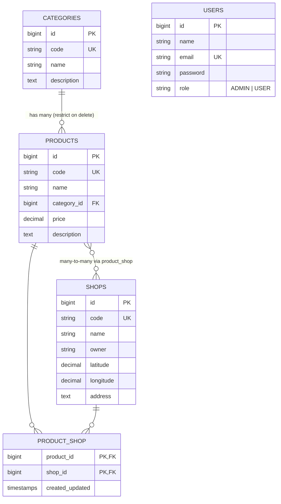

# my-db — สรุปโปรเจกต์เว็บ (Lec + Lab 07–13)

เว็บจัดการข้อมูล **สินค้า (Product) – ร้านค้า (Shop) – หมวดหมู่ (Category) – ผู้ใช้ (User)** เขียนด้วย **Laravel 13 (PHP 8.3)** ใช้ Blade เป็น view, Eloquent ORM ต่อฐานข้อมูล MySQL และใช้ CSS ของรายวิชา (`lec04-styles.css`, `sematic-ui.css`)

> หมายเหตุ: การจับคู่ "Lab ไหนทำอะไร" ด้านล่าง อนุมานจากประวัติ git commit (`week8`, `lab-09`, `lab10-1,2-nf`) วันที่ของ migration และคอมเมนต์ในโค้ด (เช่น `Lab 11 hint`) — ส่วน Lab 11–13 ยังไม่ได้ commit แต่อยู่ในไฟล์แล้ว

---

## สารบัญ

1. [ภาพรวมตาม Lab](#1-ภาพรวมตาม-lab)
2. [โครงสร้างโฟลเดอร์ที่สำคัญ](#2-โครงสร้างโฟลเดอร์ที่สำคัญ)
3. [ฐานข้อมูล (Migrations + ER Diagram)](#3-ฐานข้อมูล)
4. [Models และ Relationships](#4-models-และ-relationships)
5. [Routes ทั้งหมด](#5-routes-ทั้งหมด)
6. [Controllers](#6-controllers)
7. [Search / Filter / Pagination](#7-search--filter--pagination)
8. [ความสัมพันธ์: เพิ่ม/ลบ Shop–Product, ย้าย Product เข้า Category](#8-การจัดการความสัมพันธ์)
9. [Bookmarks (ปุ่ม Back/Cancel ที่จำหน้าเดิม)](#9-bookmarks)
10. [Authentication (Login/Logout)](#10-authentication)
11. [Authorization (Policies + Roles)](#11-authorization)
12. [User Management](#12-user-management)
13. [Error Handling](#13-error-handling)
14. [Views (Blade)](#14-views-blade)
15. [วิธีรันโปรเจกต์](#15-วิธีรันโปรเจกต์)
16. [ข้อสังเกต / จุดที่ควรแก้](#16-ข้อสังเกต--จุดที่ควรแก้)

---

## 1. ภาพรวมตาม Lab

| ช่วง | Commit / หลักฐาน | สิ่งที่ทำ |
|---|---|---|
| ก่อน Lab 07 | `test` (14 ส.ค.) | ตาราง `products`, `shops` + หน้า list/view พื้นฐาน |
| **Lab 07–08** | `week8` (4 ก.ย.) | `SearchableController` (ค้นหาแบบหลายคำ), กรองราคา min/max, **Pagination** (semantic-ui), ฟอร์ม **Create / Update / Delete** ของ Product และ Shop, seeder ข้อมูลเพิ่ม (`Product02Seeder`, `Shop02Seeder`) |
| **Lab 09** | `lab-09` (11 ก.ย.) | **Relationships**: ตาราง pivot `product_shop` (Many-to-Many), ตาราง `categories` + FK `category_id` ใน products (One-to-Many), หน้า `view-shops` / `view-products`, CRUD ของ Category |
| **Lab 10** | `lab10-1,2-nf` (18 ก.ย.) | **เพิ่ม/ลบความสัมพันธ์**: `attach()` / `detach()` Shop↔Product, `associate()` Product→Category, ฟอร์ม `add-shops-form`, `add-products-form`, เลือก Category ตอนสร้าง Product |
| **Lab 11** | คอมเมนต์ `Lab 11 hint` ใน layout | **Bookmarks** ใน session ให้ปุ่ม Back/Cancel กลับไปหน้าเดิมพร้อม query string |
| **Lab 12** | migration `add_column_role_to_users` (22 ก.ย.) | **Login/Logout**, middleware `auth`, คอลัมน์ `role`, **Policies** (`Gate::authorize`, `@can`) |
| **Lab 13** | migration `add_nonnullable_role_to_users` (29 ก.ย.) | **User Management** (ADMIN จัดการ user, user แก้ข้อมูลตัวเอง), ห้ามลบ/เปลี่ยน role ตัวเอง, **จับ `QueryException`** แสดงข้อความ error, ห้ามลบ Category ที่ยังมีสินค้า |

---

## 2. โครงสร้างโฟลเดอร์ที่สำคัญ

```
my-db/
├── app/
│   ├── Http/Controllers/
│   │   ├── SearchableController.php   ← คลาสแม่ (abstract) ค้นหา/กรอง/find by code
│   │   ├── ProductController.php
│   │   ├── ShopController.php
│   │   ├── CategoryController.php
│   │   ├── UserController.php
│   │   └── LoginController.php
│   ├── Models/        Product, Shop, Category, User
│   ├── Policies/      ProductPolicy, ShopPolicy, CategoryPolicy, UserPolicy
│   └── Providers/AppServiceProvider.php  ← ตั้ง pagination view = semantic-ui
├── database/
│   ├── migrations/    (สร้างตาราง + ใส่ข้อมูลตั้งต้น)
│   └── seeders/       ProductSeeder, ShopSeeder, Product02Seeder, Shop02Seeder, ProductShopSeeder
├── resources/views/
│   ├── layouts/main.blade.php           ← layout หลัก (เมนู, ชื่อ user, Logout, ข้อความ status/alert)
│   ├── logins/form.blade.php
│   ├── products/ shops/ categories/ users/   ← main, list, view, create-form, update-form, ...
│   └── vendor/pagination/semantic-ui.blade.php
├── routes/web.php
└── public/css/   lec04-styles.css, sematic-ui.css
```

**รูปแบบ view ของแต่ละ resource:** `main.blade.php` (extends `layouts.main` และเติมคำนำหน้า title เช่น `Product: ...`) → หน้าอื่น ๆ extends `xxx.main` อีกที

---

## 3. ฐานข้อมูล

### Migrations (เรียงตามลำดับรัน)

| ไฟล์ | ทำอะไร |
|---|---|
| `0001_..._create_users_table` | ตาราง `users`, `password_reset_tokens`, `sessions` (ของ Laravel) |
| `2026_08_12_..._create_products_table` | `products`: id, timestamps (มี index), `code` (unique, 64), `name`, `price` decimal(15,2), `description` text + insert ข้อมูลตั้งต้น |
| `2026_08_13_..._create_shops_table` | `shops`: `code` unique, `name`, `owner`, `latitude` decimal(10,8), `longitude` decimal(11,8), `address` |
| `2026_08_18_..._create_product_shop_table` | ตาราง pivot: `product_id`, `shop_id` (FK + `cascadeOnDelete`), primary key คู่ `(product_id, shop_id)` |
| `2026_09_09_..._create_categories_table` | `categories`: `code`, `name`, `description` + ข้อมูล CT001 PHP, CT002 Python, CT003 JavaScript |
| `2026_09_09_..._add_column_category_id_to_products` | เพิ่ม `category_id` แบบ **nullable** ก่อน |
| `2026_09_09_..._add_foreign_category_id_to_product` | เติมค่า category ให้สินค้าทุกตัว (จับคู่ชื่อหมวดใน name/description, ที่เหลือใส่หมวดแรก) → เปลี่ยนเป็น **NOT NULL** + FK `restrictOnDelete` |
| `2026_09_22_..._add_column_role_to_users` | เพิ่ม `role` (string 32, nullable) |
| `2026_09_29_..._add_nonnullable_role_to_users` | user เดิมที่ไม่มี role → `USER`, สร้าง `admin@my-db.com` (ADMIN) และ `user@my-db.com` (USER) รหัส `1234` → เปลี่ยน role เป็น **NOT NULL** |

> เทคนิคสำคัญ (Lab 09, 13): **เพิ่มคอลัมน์ NOT NULL ให้ตารางที่มีข้อมูลแล้ว** ต้องทำ 3 ขั้น → เพิ่มเป็น nullable → เติมข้อมูลให้ครบ → `->nullable(false)->change()`

### ER Diagram



**พฤติกรรมตอนลบ**
- ลบ Product / Shop → แถวใน `product_shop` ถูกลบตาม (`cascadeOnDelete`)
- ลบ Category ที่ยังมี Product → DB ไม่ยอม (`restrictOnDelete`) และ Policy ก็ไม่ให้ปุ่ม Delete โผล่

---

## 4. Models และ Relationships

```php
// Product.php
#[Fillable(['code', 'name', 'price', 'description'])]
function shops(): BelongsToMany   { return $this->belongsToMany(Shop::class)->withTimestamps(); }
function category(): BelongsTo    { return $this->belongsTo(Category::class); }

// Shop.php
#[Fillable(['code', 'name', 'owner', 'latitude', 'longitude', 'address'])]
function products(): BelongsToMany { return $this->belongsToMany(Product::class)->withTimestamps(); }

// Category.php
#[Fillable(['code', 'name', 'description'])]
function products(): HasMany { return $this->hasMany(Product::class); }

// User.php
#[Fillable(['name', 'password'])]          // email, role ไม่อยู่ใน Fillable → ป้องกัน mass assignment
#[Hidden(['password', 'remember_token'])]
const array ROLES = ['ADMIN', 'USER'];
casts: 'password' => 'hashed'               // set รหัสแบบ plain แล้ว Laravel hash ให้อัตโนมัติ
function isAdministrator(): bool { return $this->role === 'ADMIN'; }
```

- ใช้ PHP Attributes `#[Fillable]` / `#[Hidden]` (แบบใหม่ของ Laravel) แทน `protected $fillable`
- `category_id` ไม่อยู่ใน Fillable → ต้องตั้งผ่าน `$product->category()->associate($category)`

---

## 5. Routes ทั้งหมด

ทุก route (ยกเว้น `/`) ถูกครอบด้วย middleware `cache.headers:no_store;no_cache;must_revalidate;max_age=0` (กันกด Back ของ browser แล้วเห็นหน้าเก่าหลัง logout) และทุก route ยกเว้น `/auth/*` ต้อง **login** (`auth`)

### Auth
| Method | URI | Name | Action |
|---|---|---|---|
| GET | `/auth/login` | `login` | showForm |
| POST | `/auth/login` | `authentication` | authenticate |
| POST | `/auth/logout` | `logout` | logout |

### Products (`/products`, name prefix `products.`)
| Method | URI | Name | Action |
|---|---|---|---|
| ANY | `/products` | `index` | redirect → `list` |
| GET | `/products/list` | `list` | list |
| GET | `/products/create` | `create-form` | showCreateForm |
| POST | `/products` | `create` | create |
| GET | `/products/{product}` | `view` | view |
| GET | `/products/{product}/update` | `update-form` | showUpdateForm |
| POST | `/products/{product}` | `update` | update |
| POST | `/products/{product}/delete` | `delete` | delete |
| GET | `/products/{product}/shops` | `view-shops` | viewShops |
| GET | `/products/{product}/shops/add` | `add-shops-form` | showAddShopsForm |
| POST | `/products/{product}/shops` | `add-shop` | addShop |
| POST | `/products/{product}/shops/remove` | `remove-shop` | removeShop |

### Shops (`/shops`) — โครงเดียวกับ Products
`list`, `create-form`, `create`, `view`, `update-form`, `update`, `delete`, `view-products`, `add-products-form`, `add-product`, `remove-product`

### Categories (`/categories`) — โครงเดียวกัน แต่ **ไม่มี remove-product**
(เพราะ Product ต้องมี category เสมอ ย้ายได้อย่างเดียว ลบออกไม่ได้)

### Users (`/users`, name prefix `users.`)
| Method | URI | Name | Action |
|---|---|---|---|
| GET | `/users` | `list` | list |
| GET | `/users/create` | `create-form` | showCreateForm |
| POST | `/users` | `create` | create |
| GET | `/users/self` | `selves.view` | viewSelf |
| GET | `/users/self/update` | `selves.update-form` | showUpdateSelfForm |
| POST | `/users/self` | `selves.update` | updateSelf |
| GET | `/users/{user}` | `view` | view |
| GET | `/users/{user}/update` | `update-form` | showUpdateForm |
| POST | `/users/{user}` | `update` | update |
| POST | `/users/{user}/delete` | `delete` | delete |

> `/users/self/*` ต้องประกาศ **ก่อน** `/users/{user}` ไม่งั้นคำว่า `self` จะถูกจับเป็นพารามิเตอร์ `{user}`

> route parameter ใช้ **code** (หรือ **email** สำหรับ user) ไม่ใช่ id เช่น `/products/PD001`

---

## 6. Controllers

### `SearchableController` (abstract, คลาสแม่)
| เมธอด | หน้าที่ |
|---|---|
| `MAX_ITEMS = 5` | จำนวนรายการต่อหน้า |
| `abstract getQuery()` | ลูกต้อง override เช่น `Product::orderBy('code')` |
| `prepareCriteria($criteria)` | ใส่ค่า default `term = null` |
| `getFilterOptions()` | ฟิลด์ที่ค้นได้ (default: `code`, `name`) |
| `filterByTerm()` (final) | แยก term เป็นคำ ๆ แต่ละคำต้องเจอในฟิลด์ใดฟิลด์หนึ่ง |
| `filter()` | เรียก filterByTerm ถ้ามี term (ลูก override เพิ่มเงื่อนไขได้) |
| `search($criteria)` (final) | `getQuery()` + `filter()` → คืน Builder |
| `find($code)` | หา record ด้วย code, ไม่เจอ → 404 (`firstOrFail`) |

### คลาสลูก
| Controller | override ที่น่าสนใจ |
|---|---|
| `ProductController` | เพิ่ม `minPrice`/`maxPrice` ใน criteria และ filter; ค้นด้วยชื่อ category ได้ (`whereHas`), ปิดได้ด้วย `includeCategory: false` |
| `ShopController` | ค้นเพิ่มที่ฟิลด์ `owner` |
| `CategoryController` | ใช้ filter default; list แสดง `withCount('products')` |
| `UserController` | เรียงตาม `email`, ค้นที่ `email/name/role`, override `find()` ให้หาด้วย email |
| `LoginController` | ไม่ได้สืบทอด Searchable |

### รูปแบบเมธอด CRUD (ทุก controller เหมือนกัน)
```
list → view → showCreateForm/create → showUpdateForm/update → delete
```
ทุกเมธอดเริ่มด้วย `Gate::authorize('<ability>', ...)` และ create/update/delete ห่อด้วย `try/catch` (ดูข้อ 13)

**การรับข้อมูล:** ใช้ `ServerRequestInterface` (PSR-7) → `$request->getQueryParams()` สำหรับ GET, `$request->getParsedBody()` สำหรับ POST (ต้องมี package `nyholm/psr7` + `symfony/psr-http-message-bridge`)

---

## 7. Search / Filter / Pagination

ตัวอย่าง: ค้น `php guide` ใน Product list จะได้ SQL ประมาณ
```sql
WHERE (code LIKE '%php%' OR name LIKE '%php%' OR category.name LIKE '%php%')
  AND (code LIKE '%guide%' OR name LIKE '%guide%' OR category.name LIKE '%guide%')
  AND price >= :minPrice AND price <= :maxPrice
ORDER BY code
```

- **Pagination:** `$query->paginate(static::MAX_ITEMS)` และใน view `{{ $products->withQueryString()->links() }}` (เก็บ `term`, `minPrice` ไว้ตอนเปลี่ยนหน้า)
- ตั้ง pagination template เป็น semantic-ui ใน `AppServiceProvider::boot()`
- **กัน N+1 query:** `->with('category')` (eager load) และ `->withCount('shops')` → ได้ `$product->shops_count`

---

## 8. การจัดการความสัมพันธ์

### Product ↔ Shop (Many-to-Many)
| งาน | โค้ด |
|---|---|
| ดู shop ของ product | `$product->shops()->withCount('products')` + filter ของ ShopController |
| ฟอร์มเพิ่ม: แสดงเฉพาะ shop ที่ **ยังไม่มี** product นี้ | `whereDoesntHave('products', fn($q) => $q->where('code', $product->code))` |
| เพิ่ม | `$product->shops()->attach($shop)` |
| ลบ | `$product->shops()->detach($shop)` |

ฝั่ง Shop ทำกลับกัน (`$shop->products()->attach/detach`)

> ตอน `addShop` จะ query ซ้ำผ่าน `filterOutShopByProduct` ก่อน `firstOrFail()` → ถ้ามีคนส่ง code ที่ซ้ำ/ไม่มีจริงเข้ามา จะได้ error แทนการ attach ซ้ำ

### Product → Category (One-to-Many)
| งาน | โค้ด |
|---|---|
| สร้าง/แก้ product | รับ `category` (code) จาก `<select>` → `Category::where('code', ...)->firstOrFail()` → `$product->category()->associate($category)` |
| ฟอร์มย้าย product เข้าหมวด | แสดง product ที่ `category_id != $category->id` |
| ย้าย | `$product->category()->associate($category); $product->save();` |
| ดู product ในหมวด | `$category->products()` โดย **ไม่ให้ค้นด้วยชื่อ category** (`includeCategory: false`) เพราะทุกตัวอยู่หมวดเดียวกันอยู่แล้ว |

**การใช้ Controller อื่น:** `\resolve(ProductController::class)` เพื่อยืม `prepareCriteria/filter/search` มาใช้ใน ShopController/CategoryController

**ปุ่ม Add ในตาราง:** ใช้ฟอร์มเดียวนอกตาราง แล้วปุ่มแต่ละแถวอ้างด้วย `form="..."`
```blade
<form action="{{ route('products.add-shop', ['product' => $product->code]) }}" id="app-form-add-shop" method="post">@csrf</form>
...
<button type="submit" form="app-form-add-shop" name="shop" value="{{ $shop->code }}">Add</button>
```

---

## 9. Bookmarks

ปัญหา: ปุ่ม **Back / Cancel** ถ้าใช้ `route('products.list')` ตรง ๆ จะเสียหน้าที่เคยค้น/เปลี่ยนหน้าไว้
วิธีแก้: ตอน render หน้า ให้ **จด URL ปัจจุบัน (`url()->full()`) ลง session** ไว้ล่วงหน้า สำหรับหน้าถัดไปที่ผู้ใช้อาจกดไป

```blade
{{-- products/list.blade.php : ก่อนแสดงลิงก์ไปหน้า view --}}
@php session()->put('bookmarks.products.view', url()->full()); @endphp

{{-- products/view.blade.php : ปุ่ม Back --}}
<a href="{{ session()->get('bookmarks.products.view') ?? route('products.index') }}">&lt; Back</a>
```

**ส่งต่อ bookmark หลัง create/update** (ใน controller): หลังบันทึกจะ redirect ไปหน้า view ดังนั้น Back ของหน้า view ควรกลับไปที่เดียวกับที่ฟอร์มจะกลับ
```php
if (session()->has('bookmarks.products.create')) {
    session()->put('bookmarks.products.view', session()->get('bookmarks.products.create'));
}
session()->forget('bookmarks.products.create');
```
- delete → redirect ไป `bookmarks.products.delete` (= หน้าที่มาก่อนหน้า view) หรือ `index`
- layout จด `bookmarks.users.selves.view` ทุกหน้า (ยกเว้นหน้า self) → กดชื่อตัวเองแล้ว Back กลับหน้าเดิมได้
- debug: เปิด `@dump(session()->get('bookmarks'))` ใน layout

---

## 10. Authentication

```php
// LoginController::authenticate
$validator = Validator::make($request->getParsedBody(), ['email' => 'required', 'password' => 'required']);
if ($validator->passes() && Auth::attempt($validator->safe()->only(['email', 'password']))) {
    session()->regenerate();                                  // กัน session fixation
    return redirect()->intended(route('products.index'));     // กลับหน้าที่ตั้งใจจะเข้าก่อนโดนเด้งมา login
}
$validator->errors()->add('credentials', 'The provided credentials do not match our records.');
return redirect()->back()->withErrors($validator);

// logout
Auth::logout(); session()->invalidate(); session()->regenerateToken(); // ล้าง session + CSRF token ใหม่
return redirect()->route('login');
```
- route ชื่อ `login` เพราะ middleware `auth` ของ Laravel จะ redirect ไป route ชื่อนี้โดยอัตโนมัติ
- ปุ่ม Logout ใน layout เป็น `POST` + `@csrf` (ไม่ใช้ลิงก์ GET)
- `@auth ... @endauth` แสดงชื่อ user (ลิงก์ไป `users.selves.view`) และปุ่ม Logout

---

## 11. Authorization

### สิทธิ์ตาม Role

| Resource | list / view | create / update | delete | หมายเหตุ |
|---|---|---|---|---|
| Product | ทุกคนที่ login | ADMIN | ADMIN | |
| Shop | ทุกคนที่ login | ADMIN | ADMIN | |
| Category | ทุกคนที่ login | ADMIN | ADMIN **และ** `products_count === 0` | ลบได้เฉพาะหมวดว่าง |
| User | ADMIN | ADMIN | ADMIN **และ** ไม่ใช่ตัวเอง | `updateRole`: ADMIN และไม่ใช่ตัวเอง |
| ข้อมูลตัวเอง (`/users/self`) | ทุกคน | ทุกคน (แก้ได้แค่ name, password) | – | |

Policy ถูกจับคู่กับ Model อัตโนมัติตามชื่อ (`Product` → `ProductPolicy`)

### ใช้ 2 ชั้น
```php
// Controller: ห้ามจริง (ถ้าไม่มีสิทธิ์ → 403)
Gate::authorize('update', $product);
```
```blade
{{-- View: ซ่อนปุ่มที่ไม่มีสิทธิ์ --}}
@can('create', \App\Models\Product::class) <a href="...">Create Product</a> @endcan
@can('delete', $category) <button ...>Delete</button> @endcan
```
- เมนู **User** ใน layout โผล่เฉพาะ ADMIN (`@can('list', User::class)`)
- `CategoryPolicy::delete` เรียก `$category->loadCount('products')` เพื่อให้มี `products_count` เสมอ

---

## 12. User Management

| เรื่อง | วิธีทำ |
|---|---|
| สร้าง user | `new User($data)` (name, password) แล้วตั้ง `email`, `role` ตรง ๆ เพราะไม่อยู่ใน Fillable |
| role ไม่ถูกต้อง | `abort_unless(in_array($role, User::ROLES, true), 400, 'Invalid role.')` |
| แก้ user | email **แก้ไม่ได้** (แสดงเป็นข้อความ ไม่ใช่ input) |
| ไม่อยากเปลี่ยนรหัส | ช่อง password ว่าง → `unset($data['password'])` (`preparePasswordData`) |
| เปลี่ยน role | เฉพาะเมื่อ `Gate::check('updateRole', $user)` ผ่าน (แก้ role ตัวเองไม่ได้), ใน view ใช้ `@can('updateRole') ... @else ... @endcan` |
| ลบ user | Policy ห้ามลบตัวเอง |
| แก้ข้อมูลตัวเอง | `/users/self` ใช้ `Auth::user()` → fill แค่ name/password |

---

## 13. Error Handling

ทุก create / update / delete / add / remove:
```php
try {
    ...
} catch (QueryException $excp) {
    return redirect()->back()->withInput()->withErrors(['alert' => $excp->errorInfo[2]]);   // ข้อความจาก DB เช่น Duplicate entry
} catch (\Exception $excp) {
    return redirect()->back()->withInput()->withErrors(['alert' => $excp->getMessage()]);
}
```
- `withInput()` → ฟอร์มใช้ `old('code')` / `old('name', $product->name)` เติมค่าเดิมกลับให้
- delete/add/remove ของ Product **ไม่ใช้** `withInput()` (ไม่ใช่ฟอร์มกรอกข้อมูล)
- layout แสดงผล:
```blade
@session('status') <div role="status">{{ $value }}</div> @endsession
@error('alert') <div role="alert" class="error">{{ $message }}</div> @enderror
```
- สำเร็จ → `->with('status', "Product {$product->code} was created.")`

---

## 14. Views (Blade)

| Directive / helper | ใช้ทำอะไร |
|---|---|
| `@extends`, `@section`, `@yield`, `@show` | layout หลายชั้น (`layouts.main` → `products.main` → `products.list`) |
| `@csrf` | ทุกฟอร์ม POST |
| `@class([...])` | ไฮไลต์เมนูที่ active (`Route::is('products.*')`) |
| `@can / @endcan`, `@auth` | ซ่อน/แสดงตามสิทธิ์ |
| `@selected(...)` | เลือก option เดิมใน `<select>` |
| `old('field', default)` | คืนค่าที่กรอกไว้หลัง validation/error |
| `@session`, `@error` | แสดงข้อความ status/alert |
| `number_format((float) $price, 2)` | จัดรูปราคา |
| `<search>`, `<fieldset>` | ฟอร์มค้นหาที่หัวตาราง |
| `<dl>`, `<table class="app-cmp-data-list">` | หน้า view / หน้า list |

ปุ่ม Delete ใช้ฟอร์มแยก `id="app-form-delete"` แล้วปุ่มอ้าง `form="app-form-delete"` (วางปุ่มที่ไหนก็ได้)

---

## 15. วิธีรันโปรเจกต์

```bash
composer install
cp .env.example .env        # ถ้ายังไม่มี .env
php artisan key:generate

# .env : DB_CONNECTION=mysql, DB_DATABASE=<ชื่อฐานข้อมูล>, DB_USERNAME=root
php artisan migrate         # สร้างตาราง + ข้อมูลตั้งต้น + บัญชี admin/user
php artisan db:seed --class=ProductSeeder      # (ถ้าต้องการข้อมูลเพิ่ม)
php artisan db:seed --class=ShopSeeder
php artisan db:seed --class=ProductShopSeeder

php artisan serve           # http://127.0.0.1:8000
```

**บัญชีทดสอบ** (สร้างใน migration `2026_09_29_...`)
| Email | Password | Role |
|---|---|---|
| `admin@my-db.com` | `1234` | ADMIN |
| `user@my-db.com` | `1234` | USER |

---

## 16. ข้อสังเกต / จุดที่ควรแก้

1. **Route ซ้ำใน `web.php`** — ในกลุ่ม products/shops/categories มี
   ```php
   Route::post('', 'list')->name('list');
   Route::post('', 'create')->name('create');
   ```
   method + URI เดียวกัน บรรทัดหลังทับบรรทัดแรก ทำให้ `POST ''` → `list` ไม่เคยถูกใช้ ระบบยังทำงานปกติ (ชื่อ `xxx.list` ยังชี้ไป `GET /list`) แต่ลบบรรทัด `Route::post('', 'list')` ออกได้เพื่อความชัดเจน
2. **`DatabaseSeeder` จะพัง** ถ้ารัน `php artisan db:seed` เฉย ๆ — สร้าง `test@example.com` ผ่าน `UserFactory` ซึ่งไม่ได้ใส่ `role` แต่คอลัมน์ `role` เป็น NOT NULL แล้ว → แก้โดยเพิ่ม `'role' => 'USER'` ใน factory หรือใน `create([...])`
3. **ชื่อเมธอดสับสน** — ใน `ShopController` ชื่อ `filterOutShopByProduct()` แต่จริง ๆ กรอง *product* ที่ยังไม่อยู่ใน shop (คอมเมนต์ก็ copy มาจาก ProductController) ควรเปลี่ยนเป็น `filterOutProductsByShop()`
4. **ไม่มี validation ฝั่ง server** ตอน create/update Product/Shop/Category (พึ่ง `required` ใน HTML + error จาก DB) ถ้าข้อมูลขาดจะได้ข้อความ error ดิบจาก DB แทน
5. ชื่อไฟล์ migration มี `.php.php` ซ้อน (`add_foreign_category_id_to_product_table.php.php`) — Laravel ยังรันได้ แต่ควรเปลี่ยนชื่อให้ถูก (ระวัง: ถ้า migrate ไปแล้ว ชื่อในตาราง `migrations` จะไม่ตรง)
6. Lab 11–13 ยังไม่ได้ `git commit` (commit ล่าสุดคือ `lab10-1,2-nf`)
